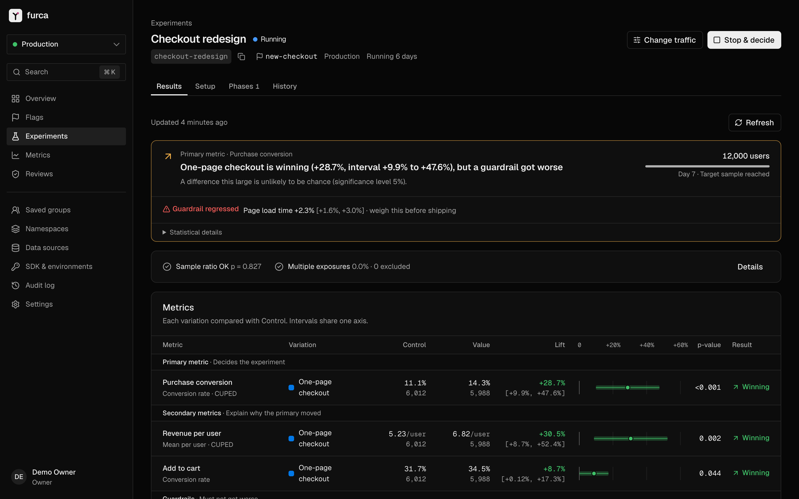
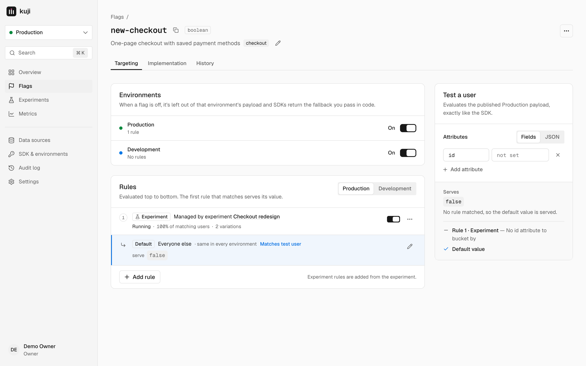

# furca

**Feature flags and A/B experiments you can trust, on your own Cloudflare account.**

furca (Latin for "fork", the root of *bifurcate*) is an open-source alternative to GrowthBook that deploys as a single
Cloudflare Worker with D1 and KV. No Docker, no MongoDB, no Python stats service. SDKs evaluate flags
locally, results use sequential testing by default, and broken data (sample ratio mismatch, multiple
exposures) blocks a decision instead of decorating it.





## Why another one

| | furca | GrowthBook (self-hosted) |
|---|---|---|
| Infrastructure | 1 Worker + D1 + KV on your account | Node app + MongoDB + Python + your warehouse |
| Start without a warehouse | Built-in event store (D1) | Needs a warehouse (managed warehouse is Cloud-only) |
| Sequential testing, CUPED | Free, sequential on by default | Paid plans |
| Flag ↔ experiment | The experiment owns its flag rule (edited in one place) | Edited in two places |
| Re-randomization | Enforced: unsafe traffic changes start a new phase | Recommended |
| Sign-up | Invite-only by default | Open sign-up cannot be disabled |
| Assignment hashing | GrowthBook-compatible (FNV-1a v2), migrate without re-bucketing | — |

What is deliberately **not** built (visual editor, bandits, holdouts, quantile metrics) and why:
[docs/product/feature-decisions.md](docs/product/feature-decisions.md) (Japanese).

## Features

- **Flags**: boolean / string / number / JSON, per-environment kill switch, ordered force and percentage
  rollout rules, attribute targeting (incl. semver and regex), "test a user" simulator
- **Experiments**: hypothesis, variations and weights, targeting and coverage, phases with enforced
  re-randomization, pre-launch power calculator, ship / roll back decisions recorded and applied to the flag
- **Statistics** (port of GrowthBook's gbstats, verified against its vectors): relative lift with the delta
  method, sequential confidence sequences (default), Bayesian chance to win, CUPED, Holm correction,
  SRM χ² check, multiple-exposure exclusion, percentile / absolute capping, cumulative timeseries
- **Metrics**: conversion, mean (count / sum), ratio; conversion windows and delays; lower-is-better
- **Data sources**: built-in event store (D1) or BigQuery with your own SQL (GA4 / Segment templates)
- **SDK**: zero-dependency TypeScript SDK with local evaluation for browsers, Workers, Node, Bun, Deno
- **Team**: email + password, first account is the owner, invitations, full audit log

## Architecture

```
your app ── @furca/sdk ──► GET  /api/sdk/v1/payload/:sdkKey  (KV, edge cached; evaluated locally)
                    └───► POST /api/sdk/v1/events/:sdkKey   (exposures + events → D1)

furca Worker (one deploy)
├── TanStack Start admin UI (HeroUI)
├── /api/rpc   oRPC v2 contract-first API, Effect 4 services
├── /api/auth  Better Auth
├── D1         flags, experiments, metrics, exposures, events, result snapshots, audit log
├── KV         SDK payload per environment
└── cron       hourly results refresh (built-in D1 or BigQuery)
```

Monorepo: `apps/web` (UI + Worker entry), `packages/{core,database,persistence,api,integrations,stats,sdk,infra}`.
See [CLAUDE.md](CLAUDE.md) for conventions.

## Deploy to your Cloudflare account

Prerequisites: a Cloudflare account and [Bun](https://bun.sh) 1.4+.

```bash
git clone https://github.com/<you>/furca && cd furca
bun install
cp .env.example .env   # fill BETTER_AUTH_SECRET and ENCRYPTION_KEY (openssl rand -hex 32)
bun alchemy profile edit --add Cloudflare   # or export CLOUDFLARE_API_TOKEN + CLOUDFLARE_ACCOUNT_ID
bun run deploy -- --stage prod
```

Open the printed URL and create the owner account. Alchemy creates the Worker, D1 database and KV
namespace and applies D1 migrations on every deploy.

### Continuous deployment (GitHub Actions)

`.github/workflows/deploy.yml` runs typecheck + tests and deploys on every push to `main`. Configure:

| Name | Kind | Value |
|---|---|---|
| `CLOUDFLARE_ACCOUNT_ID` | variable | your account id |
| `CLOUDFLARE_API_TOKEN` | secret | account token with Workers Scripts, D1, Workers KV Storage, Secrets Store and Account Settings **write** |
| `BETTER_AUTH_SECRET` | secret | `openssl rand -hex 32` |
| `ENCRYPTION_KEY` | secret | `openssl rand -hex 32` (never change it once warehouse credentials are stored) |

## Local development

```bash
bun install
cp .env.example .env    # any random values work locally
bun run dev             # http://localhost:5173 with local D1 / KV (no Cloudflare account needed)
bun scripts/seed-demo.ts http://localhost:5173   # demo flags, metrics, a running experiment and traffic
bun run check           # typecheck + tests (tests run against a real local D1 via Miniflare)
```

## SDK

```ts
import { createClient } from "@furca/sdk";

const furca = createClient({
  sdkKey: "sdk-…",
  apiHost: "https://furca.example.com",
  attributes: { id: user.id, country: "JP", plan: "pro" },
});
await furca.ready();

if (furca.isOn("new-checkout")) renderNewCheckout();
const color = furca.getValue("button-color", "blue");
furca.track("purchase", 42.5);
```

Exposures are sent automatically the first time a user is assigned to a variation. On Workers, call
`ctx.waitUntil(furca.flush())`. More: [packages/sdk/README.md](packages/sdk/README.md).

## License

MIT
